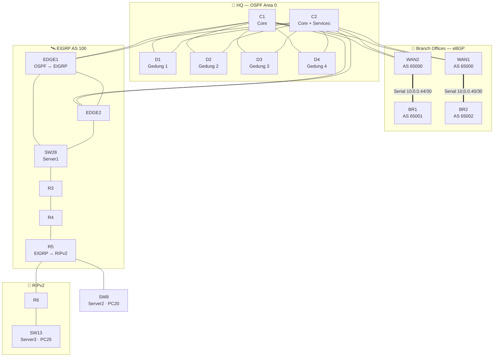

<div align="center">

# 🌐 AetherNet — Multi-Protocol Campus Network

### Cisco Packet Tracer · OSPF · eBGP · EIGRP · RIPv2 · VoIP · VLAN · DHCP · SSH


<br>


<sub>Full topology built in Cisco Packet Tracer</sub>

</div>

---

## 📑 Table of Contents

[Overview](#-overview) · [Highlights](#-highlights) · [Topology](#%EF%B8%8F-topology) · [VLAN Plan](#-vlan--subnet-plan) · [P2P Links](#-point-to-point-links) · [Config Guide](#%EF%B8%8F-configuration-guide) · [Management & AAA](#%EF%B8%8F-management-ssh--aaa) · [Configs](#-full-device-configs) · [Testing](#-verification--testing) · [Structure](#-repository-structure)

---

## 📖 Overview

AetherNet simulates a **multi-site campus network** that deliberately mixes four routing protocols, joined at controlled border points:

- **HQ (Gedung 1–4 + Core Room):** two core multilayer switches and four building switches running **OSPF Area 0**
- **Branch Offices (BR1, BR2):** remote sites reached over serial WAN links with **eBGP** (AS 65001 / AS 65002)
- **Server & Distribution Zone:** routers and a multilayer switch running **EIGRP AS 100**
- **R6 Network:** a small segment running **RIPv2**

Every building has its own data and voice VLAN, DHCP hands out addresses (and the VoIP server address through option 150), and all devices are managed over **SSH** from a dedicated management VLAN. Rules that keep the design loop-free: **route exchange between protocols happens only at `WAN1/WAN2`, `EDGE1`, and `R5`**.

## ✨ Highlights

| | | |
|:---:|:---:|:---:|
| 🔀 **4 Routing Protocols**<br>OSPF · eBGP · EIGRP · RIPv2 | 🔁 **Controlled Redistribution**<br>only at `WAN1/WAN2`, `EDGE1`, `R5` | 🧩 **VLAN per Building**<br>separate data + voice VLANs |
| ☎️ **VoIP (CME)**<br>2811 call manager, DHCP option 150 | 🗂️ **DHCP per VLAN**<br>pools on switches and routers | 🔐 **SSH + AAA**<br>management VLAN 99, RADIUS with local fallback |
| 🖥️ **Internal Services**<br>DNS · HTTP · TFTP · syslog · email · FTP · NTP | 🛰️ **Branch WAN**<br>serial links with eBGP | 🔁 **Redundancy**<br>every building dual-homed to both cores |

---

## 🗺️ Topology

### Packet Tracer view


### Logical view



### Zones & Hardware

| Zone | Role | Layer 3 Devices | Switches | End Devices |
|------|------|-----------------|----------|-------------|
| **HQ Core** | Core + shared services | `C1`, `C2` (3650) | — | `Server0`, `VOIP` (2811), `AdminCenter`, `PC17`, `PC18`, `IP Phone8` |
| **Gedung 1–4** | Building distribution | `D1`–`D4` (3650) | 2960 access switches | PCs, IP phones |
| **Branch 1** | Remote office | `BR1` (2911) + 3650 | two 2960 | `PC21`–`PC24`, `IP Phone9`, `IP Phone10` |
| **Branch 2** | Remote office | `BR2` (2911) + 3650 | two 2960 | `PC23(1)`, `PC24(1)`, IP phones |
| **Server & Distribution** | EIGRP zone | `EDGE1`, `EDGE2`, `R3`, `R4`, `R5`, `SW28` (3650) | `SW8` (2960) | `Server1`, `Server2`, `PC20` |
| **R6 Network** | RIPv2 segment | `R6` | `SW13` (2960) | `Server3`, `PC25` |

### Border points

| Device | Joins | How |
|--------|-------|-----|
| `WAN1`, `WAN2` | eBGP (branches) ↔ OSPF (HQ) | `redistribute bgp 65000 subnets` into OSPF |
| `EDGE1` | OSPF (HQ) ↔ EIGRP | two-way redistribution, **single border only** to avoid loops |
| `R5` | EIGRP ↔ RIPv2 | two-way redistribution toward `R6` |

---

## 📋 VLAN & Subnet Plan

| Location | Router / L3 Switch | Data (VLAN · Subnet) | Voice (VLAN · Subnet) | Gateway |
|----------|--------------------|----------------------|-----------------------|---------|
| **Gedung 1** | `D1` | **11** · `10.1.11.0/24` | **12** · `10.1.12.0/24` | `.1` of each subnet |
| **Gedung 2** | `D2` | **21** · `10.1.21.0/24` | **22** · `10.1.22.0/24` | `.1` of each subnet |
| **Gedung 3** | `D3` | **31** · `10.1.31.0/24` | **32** · `10.1.32.0/24` | `.1` of each subnet |
| **Gedung 4** | `D4` | **41** · `10.1.41.0/24` | **42** · `10.1.42.0/24` | `.1` of each subnet |
| **Core Room** | `C2` | **51** · `10.1.51.0/24` | **52** · `10.1.52.0/24` | `.1` of each subnet |
| **Branch 1** | `BR1` 3650 | **71** · `10.1.71.0/24` | **72** · `10.1.72.0/24` | `.1` of each subnet |
| **Branch 2** | `BR2` 3650 | **81** · `10.1.81.0/24` | **82** · `10.1.82.0/24` | `.1` of each subnet |

**Service and management networks**

| Network | Subnet | Gateway | Devices |
|---------|--------|---------|---------|
| VLAN 60 — Services | `10.1.60.0/24` | `10.1.60.1` (`C2`) | `Server0` (`10.1.60.10`) |
| VLAN 99 — Management | `10.1.99.0/24` | `10.1.99.1` (`C2`) | `AdminCenter` (`10.1.99.10`) |
| VLAN 10 — `SW28` | `10.2.10.0/24` | `10.2.10.1` (`SW28`) | `Server1` (`10.2.10.10`) |
| LAN `R5` | `10.2.20.0/24` | `10.2.20.1` (`R5`) | `Server2` (`10.2.20.10`), `PC20` |
| LAN `R6` | `10.2.30.0/24` | `10.2.30.1` (`R6`) | `Server3` (`10.2.30.10`), `PC25` |

**Router IDs**

| Device | ID | Device | ID | Device | ID |
|--------|----|--------|----|--------|----|
| `C1` | `10.255.0.1` | `D1` | `10.255.0.11` | `WAN1` | `10.255.0.21` |
| `C2` | `10.255.0.2` | `D2` | `10.255.0.12` | `WAN2` | `10.255.0.22` |
| `EDGE1` | `10.255.0.41` | `D3` | `10.255.0.13` | `BR1` | `10.255.0.31` |
| `EDGE2` | `10.255.0.42` | `D4` | `10.255.0.14` | `BR2` | `10.255.0.32` |
| `SW28` | `10.255.0.43` | `R3` | `10.255.0.44` | `R4`, `R5` | `10.255.0.45`, `.46` |

## 🔗 Point-to-Point Links

| Segment | Subnet | Side A | Side B |
|---------|--------|--------|--------|
| **C1 ↔ D1** | `10.0.0.4/30` | `C1` `g1/1/2` · `.5` | `D1` `g1/1/2` · `.6` |
| **C1 ↔ D2** | `10.0.0.12/30` | `C1` `g1/1/1` · `.13` | `D2` `g1/1/1` · `.14` |
| **C1 ↔ D3** | `10.0.0.20/30` | `C1` `g1/1/3` · `.21` | `D3` `g1/1/1` · `.22` |
| **C1 ↔ D4** | `10.0.0.28/30` | `C1` `g1/1/4` · `.29` | `D4` `g1/1/3` · `.30` |
| **C2 ↔ D1** | `10.0.0.8/30` | `C2` `g1/1/1` · `.9` | `D1` `g1/1/1` · `.10` |
| **C2 ↔ D2** | `10.0.0.16/30` | `C2` `g1/1/2` · `.17` | `D2` `g1/1/3` · `.18` |
| **C2 ↔ D3** | `10.0.0.24/30` | `C2` `g1/1/3` · `.25` | `D3` `g1/1/2` · `.26` |
| **C2 ↔ D4** | `10.0.0.32/30` | `C2` `g1/1/4` · `.33` | `D4` `g1/1/1` · `.34` |
| **C2 ↔ VOIP** | `10.0.0.36/30` | `C2` `g1/0/1` · `.37` | `VOIP` `Fa0/0` · `.38` |
| **WAN1 ↔ BR2** (serial) | `10.0.0.40/30` | `WAN1` `Se0/3/0` · `.41` | `BR2` `Se0/2/0` · `.42` |
| **WAN2 ↔ BR1** (serial) | `10.0.0.44/30` | `WAN2` `Se0/2/0` · `.45` | `BR1` `Se0/2/0` · `.46` |
| **BR1 ↔ BR1 3650** | `10.0.0.48/30` | `BR1` `Gi0/0` · `.49` | 3650 `g1/0/1` · `.50` |
| **BR2 ↔ BR2 3650** | `10.0.0.52/30` | `BR2` `Gi0/0` · `.53` | 3650 `g1/0/1` · `.54` |
| **WAN1 ↔ C1** | `10.0.0.56/30` | `WAN1` `Gi0/1` · `.58` | `C1` `g1/0/2` · `.57` |
| **WAN2 ↔ C1** | `10.0.0.60/30` | `WAN2` `Gi0/1` · `.62` | `C1` `g1/0/1` · `.61` |
| **WAN1 ↔ C2** | `10.0.0.64/30` | `WAN1` `Gi0/0` · `.66` | `C2` `g1/0/8` · `.65` |
| **WAN2 ↔ C2** | `10.0.0.68/30` | `WAN2` `Gi0/0` · `.70` | `C2` `g1/0/7` · `.69` |
| **EDGE1 ↔ SW28** | `10.0.0.72/30` | `EDGE1` `Gi0/0` · `.73` | `SW28` `g1/0/1` · `.74` |
| **EDGE2 ↔ SW28** | `10.0.0.76/30` | `EDGE2` `Gi0/0` · `.77` | `SW28` `g1/0/2` · `.78` |
| **SW28 ↔ R3** | `10.0.0.80/30` | `SW28` `g1/0/4` · `.81` | `R3` `Gi0/0` · `.82` |
| **EDGE1 ↔ EDGE2** | `10.0.0.84/30` | `EDGE1` `Gi0/2/0` · `.85` | `EDGE2` `Gi0/2/0` · `.86` |
| **R3 ↔ R4** | `10.0.0.88/30` | `R3` `Gi0/2/0` · `.89` | `R4` `Gi0/2/0` · `.90` |
| **R4 ↔ R5** | `10.0.0.92/30` | `R4` `Gi0/1/0` · `.93` | `R5` `Gi0/2/0` · `.94` |
| **R5 ↔ R6** | `10.0.0.96/30` | `R5` `Gi0/1` · `.97` | `R6` `Gi0/0` · `.98` |
| **EDGE1 ↔ C1** | `10.0.0.100/30` | `EDGE1` `Gi0/1` · `.101` | `C1` `g1/0/3` · `.102` |
| **EDGE1 ↔ C2** | `10.0.0.104/30` | `EDGE1` `Gi0/2` · `.105` | `C2` `g1/0/9` · `.106` |
| **EDGE2 ↔ C1** | `10.0.0.108/30` | `EDGE2` `Gi0/1` · `.109` | `C1` `g1/0/4` · `.110` |
| **EDGE2 ↔ C2** | `10.0.0.112/30` | `EDGE2` `Gi0/2` · `.113` | `C2` `g1/0/10` · `.114` |

> 💡 Port numbers were confirmed with `show cdp neighbors` before assigning IPs. Always check CDP first, cable labels in Packet Tracer can be misleading.

---

## ⚙️ Technologies

| Technology | What it does here |
|------------|-------------------|
| **OSPF (Area 0)** | Link-state routing across HQ, with routed `/30` uplinks between cores and building switches |
| **eBGP** | Exchanges branch prefixes between `WAN1/WAN2` (AS 65000) and `BR1` (AS 65001) / `BR2` (AS 65002) |
| **EIGRP (AS 100)** | Routing for the server and distribution zone behind `EDGE1/EDGE2` |
| **RIPv2** | Routing for the `R6` segment, redistributed at `R5` |
| **Route Redistribution** | Connects the protocols at three controlled border points |
| **VLAN & SVI** | Separate data and voice broadcast domains per building, inter-VLAN routing on multilayer switches |
| **DHCP** | Per-VLAN pools; voice pools carry `option 150` pointing to the call manager |
| **Cisco Call Manager Express** | IP phone registration and extensions on the `VOIP` router |
| **SSH v2** | Secure device management from `AdminCenter` in VLAN 99 |
| **AAA (RADIUS)** | Central login on routers via `Server2`, local user as fallback |
| **DNS · HTTP · TFTP · Syslog · Email · FTP · NTP** | Internal services hosted on `Server0` to `Server3` |

---

## 🛠️ Configuration Guide

> Follow the steps in order. Complete per-device scripts are in [Full Device Configs](#-full-device-configs).

| Step | Task | Done on |
|:----:|------|---------|
| 1 | Map cables with CDP and verify the IP plan | All devices |
| 2 | Create VLANs, access ports, and trunks | Access switches |
| 3 | Configure routed links and SVIs | `C1`, `C2`, `D1`–`D4`, branch 3650s |
| 4 | Enable OSPF (Area 0) | HQ + `WAN1/WAN2` + `EDGE1/EDGE2` |
| 5 | Configure serial WAN and eBGP | `WAN1`, `WAN2`, `BR1`, `BR2` |
| 6 | Configure EIGRP and redistribution | `EDGE1`, `EDGE2`, `SW28`, `R3`–`R5` |
| 7 | Configure RIPv2 | `R5`, `R6` |
| 8 | Configure DHCP pools | Switches and routers |
| 9 | Set up VoIP (CME) | `VOIP` |
| 10 | Management: SSH, syslog, DNS, AAA | All devices + servers |
| 11 | Save and verify | All devices |

---

### 1️⃣ Cable Mapping with CDP

Before assigning any IP, map every cable:

```cisco
show cdp neighbors
```

Compare *Local Interface* and *Port ID* with the [P2P table](#-point-to-point-links). Router ports are `administratively down` by default, so run `no shutdown` first or CDP will not see the neighbor.

✅ **Check:** every link in the table appears in CDP on both ends

---

### 2️⃣ Access Switches: VLAN, Access Ports, Trunks

Example (branch access switch, VLAN 71 data and VLAN 72 voice):

```cisco
enable
configure terminal
hostname BR1-A1
!
vlan 71
 name DATA-BR1
vlan 72
 name VOICE-BR1
!
interface range g0/1 - 2
 switchport mode trunk
!
interface range fa0/1 - 2
 description PCs
 switchport mode access
 switchport access vlan 71
 spanning-tree portfast
!
interface fa0/3
 description IP Phone
 switchport mode access
 switchport access vlan 71
 switchport voice vlan 72
 spanning-tree portfast
!
end
write memory
```

✅ **Check:** `show vlan brief` and `show interfaces trunk`

---

### 3️⃣ Multilayer Switches: Routed Links, SVIs, OSPF

Example (`D2`, Gedung 2):

```cisco
ip routing
!
vlan 21
 name DATA-G2
vlan 22
 name VOICE-G2
!
interface g1/1/1
 description To C1
 no switchport
 ip address 10.0.0.14 255.255.255.252
 no shutdown
interface g1/1/3
 description To C2
 no switchport
 ip address 10.0.0.18 255.255.255.252
 no shutdown
!
interface vlan 21
 ip address 10.1.21.1 255.255.255.0
interface vlan 22
 ip address 10.1.22.1 255.255.255.0
!
router ospf 1
 router-id 10.255.0.12
 network 10.0.0.0 0.255.255.255 area 0
 passive-interface vlan 21
 passive-interface vlan 22
```

✅ **Check:** `show ip ospf neighbor` (two `FULL` neighbors: `C1` and `C2`) and `show ip route ospf`

---

### 4️⃣ Serial WAN and eBGP

Assign `/30` addresses on the serial links. `clock rate` is accepted only on the **DCE** side. Example (`WAN1` and `BR2`):

```cisco
! WAN1
interface Serial0/3/0
 ip address 10.0.0.41 255.255.255.252
 clock rate 64000
 no shutdown
router bgp 65000
 bgp router-id 10.255.0.21
 neighbor 10.0.0.42 remote-as 65002
!
! BR2
interface Serial0/2/0
 ip address 10.0.0.42 255.255.255.252
 no shutdown
ip route 10.1.81.0 255.255.255.0 10.0.0.54
ip route 10.1.82.0 255.255.255.0 10.0.0.54
ip route 0.0.0.0 0.0.0.0 10.0.0.41
router bgp 65002
 bgp router-id 10.255.0.32
 neighbor 10.0.0.41 remote-as 65000
 network 10.1.81.0 mask 255.255.255.0
 network 10.1.82.0 mask 255.255.255.0
```

> The static routes matter: BGP's `network` command only advertises prefixes that already exist in the routing table.

✅ **Check:** `show ip bgp summary` (neighbor shows a number, not `Idle` or `Active`) and `show ip bgp`

---

### 5️⃣ EIGRP and Redistribution

All EIGRP devices use AS 100. `EDGE1` is the **only** OSPF ↔ EIGRP border:

```cisco
! EDGE1
router eigrp 100
 eigrp router-id 10.255.0.41
 network 10.0.0.72 0.0.0.3
 network 10.0.0.84 0.0.0.3
 no auto-summary
 redistribute ospf 1 metric 10000 100 255 1 1500
!
router ospf 1
 router-id 10.255.0.41
 network 10.0.0.100 0.0.0.3 area 0
 network 10.0.0.104 0.0.0.3 area 0
 redistribute eigrp 100 subnets
```

✅ **Check:** `show ip eigrp neighbors`, then `show ip route ospf` on `C1` (EIGRP prefixes appear as `O E2`)

---

### 6️⃣ RIPv2 Behind R5

`R5` redistributes between EIGRP and RIP, and `R6` runs RIPv2 only:

```cisco
! R5
router eigrp 100
 redistribute rip metric 10000 100 255 1 1500
router rip
 version 2
 no auto-summary
 network 10.0.0.0
 passive-interface default
 no passive-interface g0/1
 redistribute eigrp 100 metric 2
!
! R6
router rip
 version 2
 no auto-summary
 network 10.0.0.0
 passive-interface g0/1
```

✅ **Check:** `show ip route rip` on `R6` (EIGRP-learned routes marked `R`)

---

### 7️⃣ DHCP Pools

Voice pools include `option 150` so IP phones find the call manager:

```cisco
ip dhcp excluded-address 10.1.21.1 10.1.21.10
ip dhcp excluded-address 10.1.22.1 10.1.22.10
!
ip dhcp pool G2-DATA
 network 10.1.21.0 255.255.255.0
 default-router 10.1.21.1
 dns-server 10.1.60.10
 domain-name aethernet.local
!
ip dhcp pool G2-VOICE
 network 10.1.22.0 255.255.255.0
 default-router 10.1.22.1
 option 150 ip 10.0.0.38
```

✅ **Check:** set PCs to **DHCP**, then `ipconfig`. On the switch, `show ip dhcp binding`

---

### 8️⃣ VoIP (Call Manager Express)

On the `VOIP` router (2811), each phone needs a free `ephone-dn`:

```cisco
interface fa0/0
 ip address 10.0.0.38 255.255.255.252
 no shutdown
ip route 0.0.0.0 0.0.0.0 10.0.0.37
!
telephony-service
 max-ephones 20
 max-dn 20
 ip source-address 10.0.0.38 port 2000
 auto assign 1 to 20
!
ephone-dn 1
 number 1001
ephone-dn 2
 number 1002
```

Add one `ephone-dn` per phone (numbers `1003` onward).

✅ **Check:** `show ephone` (phones listed as `REGISTERED`)

---

## 🛡️ Management, SSH & AAA

All devices are managed from `AdminCenter` (`10.1.99.10`) in VLAN 99.

### SSH

```cisco
hostname <DEVICE>
ip domain-name aethernet.local
crypto key generate rsa
! enter 1024 when prompted
ip ssh version 2
username <ADMIN_USER> privilege 15 secret <STRONG_PASSWORD>
line vty 0 15
 transport input ssh
 login local
```

### Logging and time

```cisco
service timestamps log datetime msec
logging host 10.1.60.10
ntp server 10.2.10.10
```

### AAA with local fallback (routers)

```cisco
aaa new-model
radius-server host 10.2.20.10 key <RADIUS_SECRET>
aaa authentication login default group radius local
line vty 0 4
 login authentication default
```

On `Server2`: **Services → AAA → On**, add each router IP under *Network Configuration* (Server Type `Radius`), then create the user under *User Setup*. The trailing `local` keeps the local account working when the server is unreachable.

### Internal services

| Server | Address | Role |
|--------|---------|------|
| `Server0` | `10.1.60.10` | DNS (primary), HTTP portal, TFTP, syslog |
| `Server1` | `10.2.10.10` | Email, FTP, NTP |
| `Server2` | `10.2.20.10` | AAA (RADIUS) |
| `Server3` | `10.2.30.10` | DNS (secondary) and documentation page |
| `AdminCenter` | `10.1.99.10` | Management PC |

> 🔒 No real credentials are stored in this repository. Replace the `<PLACEHOLDERS>` with your own lab values.

---

## 📦 Full Device Configs

<details>
<summary><b>🧱 C2 — Core + Services (3650)</b></summary>

```cisco
enable
configure terminal
hostname C2
no ip domain-lookup
ip routing
!
vlan 51
 name DATA-C2
vlan 52
 name VOICE-C2
vlan 60
 name SERVER
vlan 99
 name MANAGEMENT
!
interface g1/1/1
 description To D1
 no switchport
 ip address 10.0.0.9 255.255.255.252
 no shutdown
interface g1/1/2
 description To D2
 no switchport
 ip address 10.0.0.17 255.255.255.252
 no shutdown
interface g1/1/3
 description To D3
 no switchport
 ip address 10.0.0.25 255.255.255.252
 no shutdown
interface g1/1/4
 description To D4
 no switchport
 ip address 10.0.0.33 255.255.255.252
 no shutdown
!
interface g1/0/1
 description To VOIP
 no switchport
 ip address 10.0.0.37 255.255.255.252
 no shutdown
interface g1/0/7
 description To WAN2
 no switchport
 ip address 10.0.0.69 255.255.255.252
 no shutdown
interface g1/0/8
 description To WAN1
 no switchport
 ip address 10.0.0.65 255.255.255.252
 no shutdown
interface g1/0/9
 description To EDGE1
 no switchport
 ip address 10.0.0.106 255.255.255.252
 no shutdown
interface g1/0/10
 description To EDGE2
 no switchport
 ip address 10.0.0.114 255.255.255.252
 no shutdown
!
interface vlan 51
 ip address 10.1.51.1 255.255.255.0
interface vlan 52
 ip address 10.1.52.1 255.255.255.0
interface vlan 60
 ip address 10.1.60.1 255.255.255.0
interface vlan 99
 ip address 10.1.99.1 255.255.255.0
!
interface g1/0/2
 description AdminCenter
 switchport mode access
 switchport access vlan 99
 spanning-tree portfast
interface range g1/0/3 - 4
 description PCs
 switchport mode access
 switchport access vlan 51
 spanning-tree portfast
interface g1/0/5
 description IP Phone
 switchport mode access
 switchport access vlan 52
 spanning-tree portfast
interface g1/0/6
 description Server0
 switchport mode access
 switchport access vlan 60
 spanning-tree portfast
!
ip dhcp excluded-address 10.1.51.1 10.1.51.10
ip dhcp excluded-address 10.1.52.1 10.1.52.10
ip dhcp pool C2-DATA
 network 10.1.51.0 255.255.255.0
 default-router 10.1.51.1
 dns-server 10.1.60.10
 domain-name aethernet.local
ip dhcp pool C2-VOICE
 network 10.1.52.0 255.255.255.0
 default-router 10.1.52.1
 option 150 ip 10.0.0.38
!
router ospf 1
 router-id 10.255.0.2
 network 10.0.0.0 0.255.255.255 area 0
 passive-interface vlan 51
 passive-interface vlan 52
 passive-interface vlan 60
 passive-interface vlan 99
!
service timestamps log datetime msec
logging host 10.1.60.10
ip domain-name aethernet.local
ip ssh version 2
username <ADMIN_USER> privilege 15 secret <STRONG_PASSWORD>
line vty 0 15
 transport input ssh
 login local
!
end
write memory
```

</details>

<details>
<summary><b>🧱 D2 — Building Switch, Gedung 2 (3650)</b></summary>

```cisco
enable
configure terminal
hostname D2
no ip domain-lookup
ip routing
!
vlan 21
 name DATA-G2
vlan 22
 name VOICE-G2
!
interface g1/1/1
 description To C1
 no switchport
 ip address 10.0.0.14 255.255.255.252
 no shutdown
interface g1/1/3
 description To C2
 no switchport
 ip address 10.0.0.18 255.255.255.252
 no shutdown
!
interface vlan 21
 ip address 10.1.21.1 255.255.255.0
interface vlan 22
 ip address 10.1.22.1 255.255.255.0
!
ip dhcp excluded-address 10.1.21.1 10.1.21.10
ip dhcp excluded-address 10.1.22.1 10.1.22.10
ip dhcp pool G2-DATA
 network 10.1.21.0 255.255.255.0
 default-router 10.1.21.1
 dns-server 10.1.60.10
 domain-name aethernet.local
ip dhcp pool G2-VOICE
 network 10.1.22.0 255.255.255.0
 default-router 10.1.22.1
 option 150 ip 10.0.0.38
!
router ospf 1
 router-id 10.255.0.12
 network 10.0.0.0 0.255.255.255 area 0
 passive-interface vlan 21
 passive-interface vlan 22
!
service timestamps log datetime msec
logging host 10.1.60.10
ip domain-name aethernet.local
ip ssh version 2
username <ADMIN_USER> privilege 15 secret <STRONG_PASSWORD>
line vty 0 15
 transport input ssh
 login local
!
end
write memory
```

> `D1`, `D3`, and `D4` follow the same pattern. Change VLAN numbers, subnets, router ID, and uplink IPs from the tables above.

</details>

<details>
<summary><b>🔀 WAN1 (2911)</b></summary>

```cisco
enable
configure terminal
hostname WAN1
no ip domain-lookup
!
interface loopback0
 ip address 10.255.0.21 255.255.255.255
interface Serial0/3/0
 description To BR2 (eBGP)
 ip address 10.0.0.41 255.255.255.252
 clock rate 64000
 no shutdown
interface g0/1
 description To C1
 ip address 10.0.0.58 255.255.255.252
 no shutdown
interface g0/0
 description To C2
 ip address 10.0.0.66 255.255.255.252
 no shutdown
!
router ospf 1
 router-id 10.255.0.21
 network 10.0.0.56 0.0.0.3 area 0
 network 10.0.0.64 0.0.0.3 area 0
 network 10.255.0.21 0.0.0.0 area 0
 redistribute bgp 65000 subnets
!
router bgp 65000
 bgp router-id 10.255.0.21
 neighbor 10.0.0.42 remote-as 65002
!
end
write memory
```

> `WAN2` mirrors this config: loopback `10.255.0.22`, `Serial0/2/0` = `10.0.0.45`, `Gi0/1` = `10.0.0.62`, `Gi0/0` = `10.0.0.70`, and `neighbor 10.0.0.46 remote-as 65001`.

</details>

<details>
<summary><b>🔀 BR1 (2911) and its 3650</b></summary>

```cisco
! ---------- BR1 router ----------
enable
configure terminal
hostname BR1
no ip domain-lookup
!
interface Serial0/2/0
 description To WAN2 (eBGP)
 ip address 10.0.0.46 255.255.255.252
 clock rate 64000
 no shutdown
interface g0/0
 description To BR1 3650
 ip address 10.0.0.49 255.255.255.252
 no shutdown
!
ip route 10.1.71.0 255.255.255.0 10.0.0.50
ip route 10.1.72.0 255.255.255.0 10.0.0.50
ip route 0.0.0.0 0.0.0.0 10.0.0.45
!
router bgp 65001
 bgp router-id 10.255.0.31
 neighbor 10.0.0.45 remote-as 65000
 network 10.1.71.0 mask 255.255.255.0
 network 10.1.72.0 mask 255.255.255.0
!
end
write memory
```

```cisco
! ---------- BR1 multilayer switch ----------
enable
configure terminal
hostname BR1-SW
no ip domain-lookup
ip routing
!
vlan 71
 name DATA-BR1
vlan 72
 name VOICE-BR1
!
interface g1/0/1
 description To BR1
 no switchport
 ip address 10.0.0.50 255.255.255.252
 no shutdown
interface vlan 71
 ip address 10.1.71.1 255.255.255.0
interface vlan 72
 ip address 10.1.72.1 255.255.255.0
!
ip route 0.0.0.0 0.0.0.0 10.0.0.49
!
ip dhcp excluded-address 10.1.71.1 10.1.71.10
ip dhcp excluded-address 10.1.72.1 10.1.72.10
ip dhcp pool BR1-DATA
 network 10.1.71.0 255.255.255.0
 default-router 10.1.71.1
 dns-server 10.1.60.10
 domain-name aethernet.local
ip dhcp pool BR1-VOICE
 network 10.1.72.0 255.255.255.0
 default-router 10.1.72.1
 option 150 ip 10.0.0.38
!
interface range g1/0/2 - 3
 switchport mode trunk
!
end
write memory
```

> `BR2` and its 3650 use the same pattern with AS 65002, VLAN 81/82, and subnets `10.0.0.40/30` and `10.0.0.52/30`.

</details>

<details>
<summary><b>🔀 EDGE1 — OSPF ↔ EIGRP Border (2911)</b></summary>

```cisco
enable
configure terminal
hostname EDGE1
no ip domain-lookup
!
interface g0/0
 description To SW28
 ip address 10.0.0.73 255.255.255.252
 no shutdown
interface g0/2/0
 description To EDGE2
 ip address 10.0.0.85 255.255.255.252
 no shutdown
interface g0/1
 description To C1
 ip address 10.0.0.101 255.255.255.252
 no shutdown
interface g0/2
 description To C2
 ip address 10.0.0.105 255.255.255.252
 no shutdown
!
router eigrp 100
 eigrp router-id 10.255.0.41
 network 10.0.0.72 0.0.0.3
 network 10.0.0.84 0.0.0.3
 no auto-summary
 redistribute ospf 1 metric 10000 100 255 1 1500
!
router ospf 1
 router-id 10.255.0.41
 network 10.0.0.100 0.0.0.3 area 0
 network 10.0.0.104 0.0.0.3 area 0
 redistribute eigrp 100 subnets
!
end
write memory
```

> `EDGE2` mirrors this config without redistribution: it only runs EIGRP on `10.0.0.76` and `10.0.0.84`, and OSPF on `10.0.0.108` and `10.0.0.112`.

</details>

<details>
<summary><b>🔀 R5 and R6 — EIGRP ↔ RIPv2</b></summary>

```cisco
! ---------- R5 ----------
enable
configure terminal
hostname R5
no ip domain-lookup
!
interface g0/2/0
 description To R4
 ip address 10.0.0.94 255.255.255.252
 no shutdown
interface g0/1
 description To R6
 ip address 10.0.0.97 255.255.255.252
 no shutdown
interface g0/0
 description LAN SW8
 ip address 10.2.20.1 255.255.255.0
 no shutdown
!
ip dhcp excluded-address 10.2.20.1 10.2.20.10
ip dhcp pool R5-LAN
 network 10.2.20.0 255.255.255.0
 default-router 10.2.20.1
 dns-server 10.2.30.10
!
router eigrp 100
 eigrp router-id 10.255.0.46
 network 10.0.0.92 0.0.0.3
 network 10.2.20.0 0.0.0.255
 no auto-summary
 passive-interface g0/0
 redistribute rip metric 10000 100 255 1 1500
!
router rip
 version 2
 no auto-summary
 network 10.0.0.0
 passive-interface default
 no passive-interface g0/1
 redistribute eigrp 100 metric 2
!
end
write memory
```

```cisco
! ---------- R6 ----------
enable
configure terminal
hostname R6
no ip domain-lookup
!
interface g0/0
 description To R5
 ip address 10.0.0.98 255.255.255.252
 no shutdown
interface g0/1
 description LAN SW13
 ip address 10.2.30.1 255.255.255.0
 no shutdown
!
ip dhcp excluded-address 10.2.30.1 10.2.30.10
ip dhcp pool R6-LAN
 network 10.2.30.0 255.255.255.0
 default-router 10.2.30.1
 dns-server 10.2.30.10
!
router rip
 version 2
 no auto-summary
 network 10.0.0.0
 passive-interface g0/1
!
end
write memory
```

</details>

<details>
<summary><b>☎️ VOIP — Call Manager Express (2811)</b></summary>

```cisco
enable
configure terminal
hostname VOIP
no ip domain-lookup
!
interface fa0/0
 description To C2
 ip address 10.0.0.38 255.255.255.252
 no shutdown
!
ip route 0.0.0.0 0.0.0.0 10.0.0.37
!
telephony-service
 max-ephones 20
 max-dn 20
 ip source-address 10.0.0.38 port 2000
 auto assign 1 to 20
!
ephone-dn 1
 number 1001
ephone-dn 2
 number 1002
ephone-dn 3
 number 1003
ephone-dn 4
 number 1004
ephone-dn 5
 number 1005
ephone-dn 6
 number 1006
ephone-dn 7
 number 1007
ephone-dn 8
 number 1008
ephone-dn 9
 number 1009
!
end
write memory
```

> Add one `ephone-dn` per extra phone (for example the branch phones).

</details>

---

## 🔧 Device Configurations

All standalone configuration files are stored in the [`configs/`](configs/) folder:

<details>
<summary><b>🧱 Multilayer Switches</b></summary>

- [C1](configs/C1.txt) · [C2](configs/C2.txt)
- [D1](configs/D1.txt) · [D2](configs/D2.txt) · [D3](configs/D3.txt) · [D4](configs/D4.txt)
- [SW28](configs/SW28.txt)
- [BR1-SW](configs/BR1-SW.txt) · [BR2-SW](configs/BR2-SW.txt)

</details>

<details>
<summary><b>🔀 Routers</b></summary>

- [WAN1](configs/WAN1.txt) · [WAN2](configs/WAN2.txt)
- [BR1](configs/BR1.txt) · [BR2](configs/BR2.txt)
- [EDGE1](configs/EDGE1.txt) · [EDGE2](configs/EDGE2.txt)
- [R3](configs/R3.txt) · [R4](configs/R4.txt) · [R5](configs/R5.txt) · [R6](configs/R6.txt)
- [VOIP](configs/VOIP.txt)

</details>

---

## ✅ Verification & Testing

| Test | Command / Method | Expected Result |
|------|------------------|-----------------|
| **Cable Mapping** | `show cdp neighbors` | Every link matches the P2P table |
| **OSPF Neighbors** | `show ip ospf neighbor` | Cores see all building, `WAN`, and `EDGE` neighbors in `FULL` |
| **eBGP Sessions** | `show ip bgp summary` | Neighbors show a number in `State/PfxRcd`, not `Idle` or `Active` |
| **BGP Routes** | `show ip bgp` on `WAN1` / `WAN2` | Branch prefixes (`10.1.71.0`, `10.1.81.0`, ...) are listed |
| **EIGRP Neighbors** | `show ip eigrp neighbors` on `SW28` | `EDGE1`, `EDGE2`, and `R3` are present |
| **Redistribution** | `show ip route ospf` on `C1` | EIGRP and BGP prefixes appear as `O E2` |
| **RIPv2** | `show ip route rip` on `R6` | EIGRP-learned routes appear with code `R` |
| **DHCP** | `ipconfig` on a PC, `show ip dhcp binding` | Address from the correct VLAN subnet |
| **VoIP** | `show ephone` on `VOIP` | Phones listed as `REGISTERED` with extension numbers |
| **DNS** | `ping admin.aethernet.local` from any PC | Name resolves to `10.1.99.10` |
| **SSH** | `ssh -l <ADMIN_USER> 10.1.99.1` from `AdminCenter` | Login succeeds, prompt becomes `C2#` |
| **Syslog** | `Server0` → Services → SYSLOG | Entries from devices appear |
| **End-to-End** | `ping` from a branch PC to `10.1.60.10` and to `10.2.30.10` | Replies across BGP, OSPF, EIGRP, and RIP |
| **Redundancy** | Shut one core uplink on a building switch | Traffic reroutes through the other core |

---

## 🧱 Packet Tracer Limitations

Some real-IOS features are not available in the simulator, so the design was adjusted:

| Limitation | Workaround |
|------------|------------|
| iBGP is not supported | `WAN1` and `WAN2` exchange routes through OSPF instead of iBGP |
| `neighbor ... default-originate` is missing | Static default routes on the branch routers |
| RADIUS client is missing on Catalyst 3650 | AAA only on routers; switches use the local user |
| `ip radius source-interface` is missing | Each router interface is registered as a client on the server |
| `dns-server` accepts one address in DHCP pools | DNS is split by location, with no automatic failover |
| Voice VLAN is unreliable on the core 3650 port | Phone port set as an access port in the voice VLAN |
| `show ephone-dn` is missing | Check phones with `show ephone` |

---

## 📁 Repository Structure

```text
.
├── README.md
├── images/
│   └── topology.png             # Packet Tracer screenshot
├── configs/
│   ├── C1.txt
│   ├── C2.txt
│   ├── D1.txt ... D4.txt
│   ├── WAN1.txt, WAN2.txt
│   ├── BR1.txt, BR2.txt
│   ├── EDGE1.txt, EDGE2.txt
│   ├── SW28.txt
│   ├── R3.txt ... R6.txt
│   └── VOIP.txt
├── web/
│   ├── index.html               # Server0 portal page
│   └── index_server3.html       # Server3 documentation page
└── packet-tracer/
    └── aethernet.pkt
```

## 🚀 How to Run

1. Install [Cisco Packet Tracer](https://www.netacad.com/cisco-packet-tracer).
2. Clone this repository and open the `.pkt` file inside `packet-tracer/`.
3. Wait one to two minutes for OSPF, BGP, and EIGRP to converge, then run the verification tests above.

---

<div align="center">

### 👤 Author

**Revan Anugrah Wibowo**
Network Engineering student (TJKT) · SMKN 3 Kota Tangerang

[](https://www.linkedin.com/in/revan-anugrah-wibowo/)
[](https://github.com/RevanAnugrah)


⭐ If this project helps you, give it a star!

</div>
